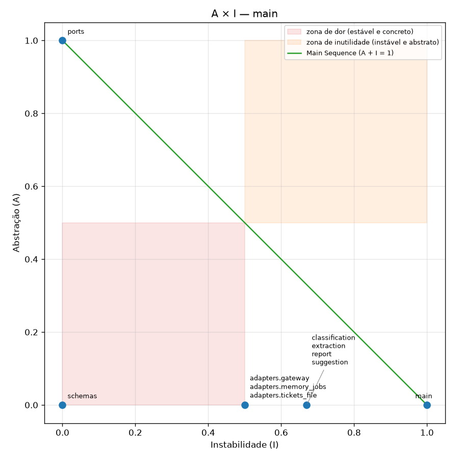

# Helpdesk com IA: da integração frágil à arquitetura resiliente

Entrega do desafio [Da integração frágil à arquitetura resiliente](https://github.com/devfullcycle/desafio-arquitetura-era-ia-1). O enunciado completo continua no repositório base.

## Visão geral

O helpdesk usa IA em quatro features e chama os modelos só pelo AI Gateway (LiteLLM, serviço `gateway`). A app pede capacidades lógicas (`ticket-classify`, `ticket-extract`, `ticket-reply`, `topics-report`) com uma chave do próprio gateway, e não conhece modelo físico, provider nem credencial. O código que fala com o gateway fica num único componente, [`app/helpdesk/adapters/gateway.py`](app/helpdesk/adapters/gateway.py), que só o ponto de composição (`main.py`) importa. Cada feature roda no modo que o contrato dela pede:

- F1 classificação e F4 extração: síncronas, com timeout;
- F2 sugestão: streaming SSE, com o primeiro trecho em ~0,9 s;
- F3 relatório do mês: assíncrona, com `202` e polling, e o relatório pronto em ~1,5 min.

Trocar o modelo de uma capacidade é editar `gateway/config.yaml` e reiniciar só o gateway. Orçamento e limite de requisições por chave são recusados no gateway, antes do provider.

Quando um provider cai, a feature continua respondendo pelo modelo equivalente do outro provider. O gateway faz 1 retry com backoff no primário (`5xx`) e então troca de destino, de forma transparente para o cliente. Se os dois modelos `large` caírem, F1, F2 e F3 respondem com o `mini` (degradação declarada), e a F4, que alimenta uma automação sem revisão, falha explicitamente com `503`, porque o `mini` troca a nota fiscal pelo número do pedido. Sem nenhum modelo, as features síncronas e o streaming respondem `503` explícito em até ~8 s, e o relatório vai para `failed` com motivo em ~6 s. Nenhum cenário chega ao `504` da borda.

## Diagnóstico da v1

Medido sobre a aplicação recebida (`app/` idêntico ao repositório base), sempre pela borda (`localhost:8000`), com o `provider-fake` como instrumento de prova. As saídas completas estão em [`docs/evidence/diagnostico/`](docs/evidence/diagnostico/) e são reproduzíveis com `scripts/diagnose.sh [d1|d2|d3-500|d3-timeout|d4|all]`. As características de cada modelo (`large` × `mini`) e os padrões dos SDKs estão em [`docs/evidence/etapa1-reconhecimento.md`](docs/evidence/etapa1-reconhecimento.md).

Os dois SDKs instalados (`openai` 3.19.0 e `anthropic` 1.8.0) usam por padrão timeout de leitura de 600 s e 2 retries, ou seja, 3 tentativas. A borda (`edge/nginx.conf`) encerra com `504` quando a app passa 30 s sem enviar nenhum byte. O timeout que vale para o usuário é o da borda, não o da aplicação.

### D1. O relatório mensal de temas nunca chega

```
curl -s -o /dev/null -w "HTTP %{http_code} total=%{time_total}s\n" -X POST localhost:8000/reports/topics \
  -H "Content-Type: application/json" -d '{"start": "2026-08-01", "end": "2026-08-31"}'
curl -s "localhost:8090/admin/calls?last=50"    # repetido a cada minuto
```

Observado ([`d1-relatorio.txt`](docs/evidence/diagnostico/d1-relatorio.txt)):

- `HTTP 504` da borda em 30,0 s, e o cliente não recebe nada.
- Depois do 504, a app continua trabalhando: as chamadas `topics` em `/admin/calls` seguem crescendo minuto a minuto (4 → 10 → … → 34) até completar os 34 lotes (5.000 tickets ÷ 150), cerca de 5,5 min depois do pedido.
- Foram consumidos 222.114 tokens de entrada e 12.162 de saída no `claude-fake-large`, ≈ US$ 0,85 pela tabela de preços do provider, gastos num relatório que ninguém vai receber. Cada nova tentativa do usuário repete o custo inteiro.

Causa:

- `app/helpdesk/report.py`, linhas 15–18: os lotes de 150 tickets são processados um depois do outro, dentro da requisição HTTP (~9,8 s por lote × 34 lotes).
- `app/helpdesk/main.py`, linhas 30–32: a rota é síncrona (`def`), roda no threadpool e não fica sabendo que o cliente desistiu. Desistir não é cancelar.
- `app/helpdesk/config.py`, linha 18: `TICKETS_PER_CALL = 150`. O mês tem ~222 mil tokens, contra 8.000 de contexto por modelo, então o particionamento é inevitável; o problema é executá-lo de forma síncrona.

### D2. A sugestão de resposta deixa o atendente olhando uma tela parada

```
curl -sN -o /dev/null -w "HTTP %{http_code} ttfb=%{time_starttransfer}s total=%{time_total}s\n" \
  -X POST localhost:8000/tickets/reply-suggestion -H "Content-Type: application/json" \
  -d '{"ticket_id": "TK-00042", "text": "Meu pedido #481516 não chegou e já passou do prazo, urgente"}'
```

Observado ([`d2-sugestao.txt`](docs/evidence/diagnostico/d2-sugestao.txt)): `HTTP 200`, `ttfb=15,98 s`, `total=15,98 s`, `content-type: application/json`. O primeiro byte chega junto com o último. `/admin/calls` mostra uma chamada `anthropic / claude-fake-large / suggest` com `stream=false`, 606 tokens de saída e 15.951 ms. Pelo README do provider, o primeiro token sai em 0,8 s; os outros ~15 s são geração que o atendente poderia estar lendo.

Causa:

- `app/helpdesk/llm.py`, linhas 20–26: `messages.create(...)` sem `stream=True`, então a resposta só existe quando o modelo termina.
- `app/helpdesk/suggestion.py`, linhas 5–7, e `main.py`, linhas 20–22: a rota devolve um JSON único.

Com ~610 tokens a 40 tokens/s, a sugestão fica a ~14 s dos 30 s da borda. Qualquer degradação do provider (modo `slow`) leva a F2 ao `504`.

### D3. Com um provider fora do ar ou travado, parte do helpdesk para

Provider fora do ar:

```
curl -s -X POST localhost:8090/admin/failures -H "Content-Type: application/json" \
  -d '{"provider": "anthropic", "mode": "error_500"}'
# depois, as 4 features pela borda
```

Observado ([`d3-provider-500.txt`](docs/evidence/diagnostico/d3-provider-500.txt)):

| Feature | Provider fixo | Resultado |
|---|---|---|
| F1 classificação | openai | `200` em 1,1 s |
| F4 extração | openai | `200` em 1,1 s |
| F2 sugestão | anthropic | `500 Internal Server Error` em 1,3 s |
| F3 relatório (1 dia) | anthropic | `500 Internal Server Error` em 1,2 s |

`/admin/calls` mostra 3 chamadas `claude-fake-large` com `status=500` por requisição de F2 e de F3: os 2 retries padrão do SDK, todos no mesmo provider caído. Nenhuma chamada foi para a OpenAI, que estava saudável e tem um modelo equivalente.

Provider travado:

```
curl -s -X POST localhost:8090/admin/failures -H "Content-Type: application/json" \
  -d '{"provider": "anthropic", "mode": "timeout"}'
# F2 pela borda; F1 em seguida
```

Observado ([`d3-provider-timeout.txt`](docs/evidence/diagnostico/d3-provider-timeout.txt)):

- F2 termina em `HTTP 504` da borda, em 30,0 s. Nesse meio-tempo, F1 (openai) responde `200` em 1,1 s.
- `/admin/calls` mostra a primeira chamada `suggest` às 22:08:51, com `duration_ms=null` (presa). Ela termina com `504` do provider em 300.004 ms, e o SDK abre a segunda tentativa às 22:13:51, cinco minutos depois de o cliente ter recebido o 504.
- Pelo padrão de 3 tentativas × 300 s, a app fica ocupada por até ~15 min por requisição abandonada.

Causa:

- `app/helpdesk/llm.py`, linhas 8–9: clientes criados sem `timeout` nem `max_retries`, então valem os 600 s / 2 retries do SDK, 20 vezes os 30 s da borda.
- `app/helpdesk/llm.py`, linhas 12–26, e `config.py`, linhas 9–13: cada feature está amarrada a um único provider e modelo físico, sem fallback.
- O retry existe, mas repete no mesmo destino que está falhando.

### D4. Trocar o modelo de uma feature exige mudar código e reconstruir a aplicação

```
# 1) troca temporária em código (desfeita em seguida)
sed -i.bak 's/^CLASSIFICATION_MODEL = "gpt-fake-large"/CLASSIFICATION_MODEL = "gpt-fake-mini"/' app/helpdesk/config.py && rm app/helpdesk/config.py.bak
docker compose restart app                       # só reiniciar
# F1 pela borda; /admin/calls?last=1
docker compose up -d --build --wait app          # reconstruir a imagem
# F1 pela borda; /admin/calls?last=1
git checkout -- app/ && docker compose up -d --build --wait app
```

Observado ([`d4-troca-modelo.txt`](docs/evidence/diagnostico/d4-troca-modelo.txt)):

| Passo | Modelo em `/admin/calls` | Tempo da F1 |
|---|---|---|
| `config.py` alterado + `docker compose restart app` | `gpt-fake-large` (a troca não teve efeito) | 1,13 s |
| `docker compose up -d --build --wait app` (rebuild de ~12 s) | `gpt-fake-mini` | 0,41 s |
| `git checkout -- app/` + rebuild | `gpt-fake-large` | 1,11 s |

Uma troca de modelo é uma mudança de código: commit, build de imagem e novo deploy da aplicação inteira, com indisponibilidade da app durante o recreate. Ao final, `git status app/` fica limpo.

Causa:

- `app/helpdesk/config.py`, linhas 10–13: nomes físicos dos modelos como constantes Python.
- `app/Dockerfile`, linha 6: `COPY helpdesk ./helpdesk`, então o código (e a configuração junto) fica congelado na imagem.
- `config.py`, linhas 3–7: o mesmo módulo carrega as chaves dos providers e as base URLs. A app conhece credencial, endereço, formato e modelo de cada provider; o `compose.yaml` entrega o `.env` inteiro ao serviço `app` (`env_file: .env`).

## Como rodar

Pré-requisitos: Docker com Compose v2 e Python 3.12.

Subida:

```
cp .env.example .env
docker compose up -d --build --wait
curl -s localhost:8000/health        # {"status":"ok"}
```

Serviços: `edge` (borda, `:8000`), `app`, `gateway` (LiteLLM, `:4000`; outra porta do host com `GATEWAY_HOST_PORT=<porta>` no `.env`, e então troque `4000` nos comandos do roteiro de governança), `db` (Postgres do gateway) e `provider-fake` (`:8090`). A chave virtual da app (`GATEWAY_APP_KEY`) é criada pelo próprio gateway a cada subida (`gateway/entrypoint.sh` + `gateway/keys.yaml`), sem passo manual. Quem já tinha um `.env` de antes do gateway precisa refazer o `cp .env.example .env`.

Testes de caracterização (contrato HTTP pela borda, com o compose no ar):

```
python3 -m venv .venv && . .venv/bin/activate
pip install -r tests/requirements.txt && pytest tests/characterization -q
```

A suíte (`tests/characterization/`) chama só `localhost:8000`, e usa `POST localhost:8090/admin/reset` antes de cada teste para deixar o provider em modo normal. Os valores esperados são golden masters capturados da app recebida: corpo completo de F1 e F4 (dois tickets, um com nota fiscal e pedido no mesmo texto), texto exato da sugestão da F2 e relatório completo de 1 dia da F3 (`tests/characterization/golden/`), além dos `422` de entrada inválida. A suíte não fixa nem a quantidade de chamadas ao provider nem qual provider atende, porque isso muda legitimamente na refatoração. Para outra base, use `HELPDESK_URL` e `PROVIDER_URL`. Leva ~30 s, quase todo na F2 (~16 s) e na F3 (~10 s).

Na `main`, F2 e F3 mudaram de modo de execução (streaming e assíncrono). Por isso, `tests/characterization/` continua idêntico ao das tags `v1-coupled` e `v2-decoupled`, onde ele é o juiz da refatoração e passa inteiro, e o contrato da `main` fica em `tests/contract/`:

```
pytest tests/contract -q          # 17 testes, ~3 min (inclui o relatório do mês e os cenários de falha)
```

A suíte de contrato reaproveita os golden masters: o texto concatenado do stream da F2 e o relatório de 1 dia da F3 são comparados com os mesmos valores da v1. Rodada na `main`, a suíte de caracterização falha de propósito em exatamente 3 testes que fixam o contrato síncrono antigo: `test_f2_sugere_resposta`, `test_f3_relatorio_de_um_dia` e `test_f3_periodo_sem_tickets`. Os outros 16 (F1, F4 e os `422`) continuam passando. Para conferir a suíte numa tag: `git worktree add ../v2 v2-decoupled`, subir aquela versão e rodar `pytest ../v2/tests/characterization -q`.

Prova de que a suíte pega mudança de comportamento (feita na v1): trocar temporariamente `EXTRACTION_MODEL` e `SUGGESTION_MODEL` de `app/helpdesk/config.py` para `mini` e reconstruir a app derruba exatamente 2 testes (F4 com nota fiscal e F2); revertido, os 19 voltam a passar. A partir da v2 o equivalente é trocar o modelo das capacidades em `gateway/config.yaml`.

Métrica de acoplamento (não precisa do compose no ar):

```
pip install -r metrics/requirements.txt
python metrics/coupling.py app/helpdesk --name <nome>        # grava metrics/results/<nome>.csv e .png
pytest metrics/tests -q                                       # testes do próprio script

# medir uma tag com o script atual:
git worktree add ../v1 v1-coupled
python metrics/coupling.py ../v1/app/helpdesk --name v1-coupled
git worktree remove ../v1
```

## Métrica

Régua do requisito 3, implementada em `metrics/coupling.py` com `ast`: componente = cada `.py` de `app/helpdesk/` (exceto `__init__.py`); dependência = import relativo ou absoluto que resolve para outro componente; A = classes que herdam de `Protocol`/`ABC` ÷ classes; I = Ce/(Ce+Ca); D = |A+I−1|.

### v1-coupled

[`metrics/results/v1-coupled.csv`](metrics/results/v1-coupled.csv) · 

| component | ca | ce | i | a | d |
|---|---|---|---|---|---|
| classification | 1 | 3 | 0.75 | 0 | 0.25 |
| config | 6 | 0 | 0 | 0 | 1 |
| extraction | 1 | 3 | 0.75 | 0 | 0.25 |
| llm | 4 | 1 | 0.2 | 0 | 0.8 |
| main | 0 | 5 | 1 | 0 | 0 |
| report | 1 | 4 | 0.8 | 0 | 0.2 |
| schemas | 5 | 0 | 0 | 0 | 1 |
| suggestion | 1 | 3 | 0.75 | 0 | 0.25 |
| tickets | 1 | 1 | 0.5 | 0 | 0.5 |

Não há nenhuma abstração (A = 0 em todos). Três componentes caem na zona de dor (I < 0,5 e A < 0,5): `config` (D = 1), `schemas` (D = 1) e `llm` (D = 0,8). `llm` é o problema real: concentra SDK, provider, formato e credencial, que são as partes voláteis, e as 4 features dependem dele. `schemas` são tipos de valor do contrato HTTP.

### v2-decoupled

[`metrics/results/v2-decoupled.csv`](metrics/results/v2-decoupled.csv) · 

| component | ca | ce | i | a | d |
|---|---|---|---|---|---|
| adapters.gateway | 1 | 1 | 0.5 | 0 | 0.5 |
| adapters.tickets_file | 1 | 1 | 0.5 | 0 | 0.5 |
| classification | 1 | 2 | 0.67 | 0 | 0.33 |
| extraction | 1 | 2 | 0.67 | 0 | 0.33 |
| main | 0 | 7 | 1 | 0 | 0 |
| ports | 6 | 0 | 0 | 1 | 0 |
| report | 1 | 2 | 0.67 | 0 | 0.33 |
| schemas | 5 | 0 | 0 | 0 | 1 |
| suggestion | 1 | 2 | 0.67 | 0 | 0.33 |

O que saiu de onde, e por quê:

- `llm` (D 0,8) deixou de existir. O papel dele foi dividido entre `ports.LLMGateway`, que é a abstração da qual as features dependem e fica sobre a reta (A = 1, I = 0), e `adapters.gateway`, o único componente da app que chama o gateway.
- `config` (D 1) também deixou de existir, absorvido por `main`, que é o ponto de composição e o único lugar que lê o ambiente.
- `tickets` virou `TicketSource`, em `ports`, mais `adapters.tickets_file`.
- As features e os adapters são folhas concretas com um único cliente (`main`), por isso ficam em I 0,5–0,67 e D 0,33–0,5, fora da zona de dor. O plano registra por que não se criaram dependências para empurrá-los para a reta.

Única exceção que sobra: `schemas`, os tipos de valor do contrato HTTP. Eles mudam só quando o contrato muda, e o contrato é fixado pela suíte. ADR da métrica: [0008](docs/adr/0008-leitura-da-metrica-e-excecoes.md).

### main

[`metrics/results/main.csv`](metrics/results/main.csv) · 

| component | ca | ce | i | a | d |
|---|---|---|---|---|---|
| adapters.gateway | 1 | 1 | 0.5 | 0 | 0.5 |
| adapters.memory_jobs | 1 | 1 | 0.5 | 0 | 0.5 |
| adapters.tickets_file | 1 | 1 | 0.5 | 0 | 0.5 |
| classification | 1 | 2 | 0.67 | 0 | 0.33 |
| extraction | 1 | 2 | 0.67 | 0 | 0.33 |
| main | 0 | 8 | 1 | 0 | 0 |
| ports | 7 | 0 | 0 | 1 | 0 |
| report | 1 | 2 | 0.67 | 0 | 0.33 |
| schemas | 5 | 0 | 0 | 0 | 1 |
| suggestion | 1 | 2 | 0.67 | 0 | 0.33 |

Os modos de execução não reacoplaram nada. O streaming entrou como `LLMGateway.stream`, na mesma porta e no mesmo adapter. O assíncrono entrou como a porta `JobStore` e o adapter `adapters.memory_jobs`, que guarda o estado em memória e é o ponto de troca se um dia for preciso fila ou banco (ADR 0004). `ports` ganhou um dependente (Ca 6 → 7) e continua sobre a reta. A zona de dor tem só `schemas`, a exceção declarada.

## Tabela de capacidades

Mapeamento em [`gateway/config.yaml`](gateway/config.yaml). A app conhece só os 4 nomes lógicos e os chama pelo componente `app/helpdesk/adapters/gateway.py`, o único da app que fala com o gateway (SDK `openai`, `max_retries=0`, timeout de 25 s). Retry, timeout e fallback moram no gateway.

| Capacidade lógica | Feature | Modelo primário | Fallback técnico | Modelo fraco | Timeout por tentativa | Máx. tentativas por destino |
|---|---|---|---|---|---|---|
| `ticket-classify` | F1 | `openai/gpt-fake-large` | `anthropic/claude-fake-large` | `openai/gpt-fake-mini` | 5 s | 2 em 5xx, 3 em 429, 1 em timeout, em cada destino |
| `ticket-extract` | F4 | `openai/gpt-fake-large` | `anthropic/claude-fake-large` | nenhum (falha explícita) | 5 s | 2 em 5xx, 3 em 429, 1 em timeout, em cada destino |
| `ticket-reply` | F2 | `anthropic/claude-fake-large` | `openai/gpt-fake-large` | `anthropic/claude-fake-mini` | 4 s até o 1º byte do stream (`stream_timeout`); 20 s sem streaming | 2 em 5xx, 3 em 429, 1 em timeout, em cada destino |
| `topics-report` | F3 (por lote) | `anthropic/claude-fake-large` | `openai/gpt-fake-large` | `anthropic/claude-fake-mini` | 20 s | 2 em 5xx, 3 em 429, 1 em timeout, em cada destino |

Política de retry (`router_settings.retry_policy`, igual para todos os destinos):

- `500`/`503` (`InternalServerErrorRetries`/`ServiceUnavailableErrorRetries: 1`): 1 retry, com backoff exponencial do LiteLLM (0,5 s × 2ⁿ + jitter de até 0,75 s).
- `429` (`RateLimitErrorRetries: 2`): 2 retries, respeitando o `Retry-After` do provider (2 s + jitter).
- Timeout (`TimeoutErrorRetries: 0`): nenhum retry, vai direto ao próximo destino. Repetir gastaria o orçamento de latência inteiro de novo.
- 4xx de requisição e o resto (`DefaultRetries: 0`): nenhum retry.
- `disable_cooldowns: true`: cada requisição percorre a cadeia inteira, então as contagens acima valem sempre, e não só para a primeira requisição depois de uma falha.

Contagens observadas em `/admin/calls`, pela borda, com `python3 scripts/resilience.py` (saídas em [`docs/evidence/resiliencia/`](docs/evidence/resiliencia/)):

| Cenário (provider-fake) | Feature | Resultado pela borda | Tentativas por destino |
|---|---|---|---|
| normal | F1 / F4 | `200` em 1,2 / 1,2 s | 1 no primário |
| normal | F2 | stream: 1º trecho em ~0,9 s, completo em ~17,8 s (606 trechos para o TK-00042, 613 para o TK-00036) | 1 no primário |
| normal | F3 (1 dia) | `202` → `303` em 10,2 s | 1 no primário |
| `anthropic` em `error_500` | F2 | stream completo (texto do large) em 20,4 s; 1º trecho em ~3,3 s | claude-large 2 → gpt-large 1 |
| `anthropic` em `error_500` | F3 (1 dia) | `202` → `303` em 12,2 s, relatório idêntico | claude-large 2 → gpt-large 1 |
| `claude-fake-large` em `timeout` | F2 | stream completo em 22,0 s; 1º trecho em ~5 s | claude-large 1 (cortado em 4 s) → gpt-large 1 |
| `anthropic` em `midstream_error` | F2 | `200`, 153 trechos e então `event: error` | claude-large 1 (o stream já começou; sem troca no meio) |
| `openai` em `error_500` | F1 / F4 | `200` em 3,4 / 3,3 s, mesma resposta | gpt-large 2 → claude-large 1 |
| os dois `large` em `error_500` | F1 | `200` em 5,5 s (mini) | gpt-large 2 → claude-large 2 → gpt-mini 1 |
| os dois `large` em `error_500` | F2 | stream com 1.096 caracteres (mini), completo em 7,1 s | claude-large 2 → gpt-large 2 → claude-mini 1 |
| os dois `large` em `error_500` | F3 (1 dia) | `202` → `303` em 7,1 s (mini; mesmo relatório) | claude-large 2 → gpt-large 2 → claude-mini 1 |
| os dois `large` em `error_500` | F4 | `503` em 4,5 s | gpt-large 2 → claude-large 2 |
| `gpt-fake-large` em `timeout` | F1 | `200` em 6,2 s (≤ 15 s) | gpt-large 1 (504, cortado em 5 s) → claude-large 1 |
| `openai` em `error_429` | F1 | `200` em 7,8 s | gpt-large 3 (intervalo ~2,3 s, Retry-After) → claude-large 1 |
| os dois providers em `error_500` | F1 / F2 | `503` em 6,7 / 7,5 s | large 2 → large 2 → mini 2 |
| os dois providers em `error_500` | F3 (mês) | `202`, depois `failed` com motivo em ~6 s | os 4 lotes já em andamento percorrem a cadeia (2 → 2 → 2 cada, 24 chamadas); nenhum lote novo começa depois da falha |
| os dois providers em `error_500` | F4 | `503` em 4,8 s | gpt-large 2 → claude-large 2 |

No `midstream_error`, o gateway não troca de destino depois que o stream começou, e o cliente recebe o `event: error` do contrato. Repetir a geração no outro provider duplicaria o texto que o atendente já está lendo.

## Tabela de fallback

O que acontece quando não há nenhum modelo `large` disponível (os dois `large` em `error_500`; cenário `large-500`):

| Feature | Comportamento | Status | O que o cliente recebe |
|---|---|---|---|
| F1 classificação | Responde com `gpt-fake-mini` | `200` | Mesmo contrato e mesma classificação (no `mini` ela é idêntica à do `large`) |
| F2 sugestão | Stream com `claude-fake-mini` (degradação declarada neste ADR/README; a resposta não sinaliza o modelo ao atendente, só o gateway e `/admin/calls` mostram) | `200` (`text/event-stream`, termina com `event: end`) | Sugestão mais curta (~45% do tamanho), com os mesmos pontos; o atendente revisa antes de enviar |
| F3 relatório | Cada lote usa `claude-fake-mini` | `202` → `303` → `200` | Mesmo relatório (no `mini` os temas e as contagens são idênticos) |
| F4 extração | Falha explícita, sem modelo fraco | `503` + `Retry-After: 30` | `{"detail": "Serviço de IA indisponível no momento. Tente novamente mais tarde.", "capability": "ticket-extract"}` |

Por que a F4 não tem `mini`: nos testes da Etapa 1, o `mini` devolve o número da nota fiscal no lugar do pedido e perde o produto (5 de 8 entradas), num formato válido que a validação da app não pega. A F4 alimenta uma automação sem revisão humana, então um pedido errado vira uma troca errada. Evidência: [`docs/evidence/etapa1-reconhecimento.md`](docs/evidence/etapa1-reconhecimento.md).

Sem nenhum modelo disponível (os dois providers fora), F1, F2 e F4 respondem `503` com o mesmo corpo (a F2 antes de abrir o stream), em até ~8 s. A F3 aceita o pedido (`202`), e o status passa a `failed` com `reason` em ~6 s. Política e evidência: [ADR 0005](docs/adr/0005-politica-de-fallback.md).

## Fluxos

Modo de cada feature e o porquê: [ADR 0004](docs/adr/0004-modo-de-execucao-por-feature.md). Contrato completo em `tests/contract/`.

F1 classificação, síncrono (≤ 3 s):

```
curl -s -X POST localhost:8000/tickets/classification -H "Content-Type: application/json" \
  -d '{"ticket_id": "TK-00042", "text": "Meu pedido #481516 não chegou e já passou do prazo, urgente"}'
# 200 {"ticket_id":"TK-00042","category":"delivery","priority":"high"}
```

F2 sugestão de resposta, streaming SSE: leia os eventos à medida que chegam. Cada `data:` traz um trecho, e o stream termina com `event: end`, ou com `event: error` se a geração for interrompida depois do `200`.

```
curl -sN -X POST localhost:8000/tickets/reply-suggestion -H "Content-Type: application/json" \
  -d '{"ticket_id": "TK-00042", "text": "Meu pedido #481516 não chegou e já passou do prazo, urgente"}'
# 200 Content-Type: text/event-stream
# data: {"chunk": "Olá!"}
# data: {"chunk": " Sin"}
# ...
# event: end
# data: {"ticket_id": "TK-00042"}
```

Erro no meio do stream (ex.: `anthropic` em `midstream_error`): `event: error` com `data: {"ticket_id": "TK-00042", "message": "A geração foi interrompida"}`. Sem nenhum modelo disponível, a resposta é `503` JSON antes de abrir o stream.

F3 relatório de temas, assíncrono: peça, guarde o `Location` e consulte até receber `303`.

```
curl -si -X POST localhost:8000/reports/topics -H "Content-Type: application/json" \
  -d '{"start": "2026-08-01", "end": "2026-08-31"}'
# 202 Accepted   Location: /reports/topics/status/<id>   Retry-After: 5
# {"id":"<id>","state":"running","status_url":"/reports/topics/status/<id>"}

curl -si localhost:8000/reports/topics/status/<id>
# 200 {"state":"running","progress":"1800/5000"}                  enquanto processa (Retry-After: 5)
# 200 {"state":"failed","progress":"0/5000","reason":"..."}         se falhar
# 303 See Other   Location: /reports/topics/<id>                  quando pronto (~1,5 min para o mês)

curl -s localhost:8000/reports/topics/<id>
# 200 {"start":"2026-08-01","end":"2026-08-31","total_tickets":5000,"topics":[...]}
```

Atalho: `curl -sL localhost:8000/reports/topics/status/<id>` mostra o status enquanto o relatório roda e o relatório quando ele fica pronto, porque segue o `303`. Um id desconhecido dá `404`, assim como pedir o resultado antes de ficar pronto. `start > end` dá `422` na hora.

F4 extração, síncrono:

```
curl -s -X POST localhost:8000/tickets/extraction -H "Content-Type: application/json" \
  -d '{"ticket_id": "TK-00036", "text": "Tenho aqui a nota fiscal 927477. Recebi o tapete de yoga e o aparelho não liga, pedido nº 389511."}'
# 200 {"ticket_id":"TK-00036","order_number":"#389511","product":"tapete de yoga"}
# 503 {"detail":"Serviço de IA indisponível no momento. Tente novamente mais tarde.","capability":"ticket-extract"}
#     com Retry-After: 30, se nenhum modelo large estiver disponível
```

## Troca de modelo

Arquivo: [`gateway/config.yaml`](gateway/config.yaml). Altere o `litellm_params` da entrada da capacidade. Por exemplo, para a F1 passar a usar o `mini`, troque a âncora `*gpt-large` por `*gpt-mini` na entrada `model_name: ticket-classify`. Para um modelo sem âncora, escreva `{model: openai/<modelo>, input_cost_per_token: ..., output_cost_per_token: ..., <<: *openai, timeout: 5}`. Depois:

```
docker compose restart gateway
```

A app não é reconstruída nem reiniciada, e os modelos vêm só do arquivo (`store_model_in_db: false`). `scripts/swap_model.sh` faz a troca da F1 de `large` para `mini`, confere e desfaz no fim ([`docs/evidence/troca-de-modelo/f1-large-para-mini.txt`](docs/evidence/troca-de-modelo/f1-large-para-mini.txt)):

| Momento | `/admin/calls` | F1 pela borda | App iniciada em |
|---|---|---|---|
| Antes | `openai gpt-fake-large classify 200` | `200` em 1,35 s | 20:27:17 |
| Depois do `restart gateway` (~18 s) | `openai gpt-fake-mini classify 200` | `200` em 0,66 s | 20:27:17 (inalterado; `docker compose ps`: app `Up 32 minutes`, gateway `Up 12 seconds`) |

As chaves virtuais sobrevivem ao restart: o entrypoint do gateway as reaplica (`provision_keys: chave ... atualizada`).

## Roteiro de governança

Chaves em [`gateway/keys.yaml`](gateway/keys.yaml), criadas pelo gateway a cada subida: `governance-budget` (`max_budget` US$ 0,0002), `governance-rpm` (`rpm_limit` 2) e a da app. Os preços dos modelos estão em `gateway/config.yaml`; sem eles o custo seria zero e o orçamento nunca estouraria. O roteiro completo é `scripts/governance.sh`, que reinicia o gateway, zera o gasto das duas chaves e conta `/admin/calls` antes e depois de cada chamada ([`docs/evidence/governanca/roteiro.txt`](docs/evidence/governanca/roteiro.txt)). À mão:

```
set -a; . ./.env; set +a
calls() { curl -s "localhost:8090/admin/calls?last=5000" | python3 -c 'import json,sys; print(len(json.load(sys.stdin)))'; }
ask() { curl -s -w "\nHTTP %{http_code}\n" localhost:4000/v1/chat/completions -H "Authorization: Bearer $1" \
  -H "Content-Type: application/json" \
  -d '{"model": "ticket-classify", "messages": [{"role": "user", "content": "TASK: classify\nMeu pedido não chegou"}]}'; }

# orçamento: cada classificação custa ~US$ 0,00015; espere uns segundos entre as chamadas (gasto é assíncrono)
calls; ask $GATEWAY_BUDGET_KEY; sleep 3; ask $GATEWAY_BUDGET_KEY; sleep 3; calls
ask $GATEWAY_BUDGET_KEY; calls      # 429 budget_exceeded, e o contador não muda

# limite de requisições: 2 por minuto
calls; ask $GATEWAY_RPM_KEY; ask $GATEWAY_RPM_KEY; ask $GATEWAY_RPM_KEY; calls   # 3ª: 429, e só 2 chamadas a mais
```

O roteiro manual pressupõe o gasto da `governance-budget` zerado: o gasto persiste no Postgres, então numa segunda execução a 1ª chamada já é recusada. Para repetir, rode `scripts/governance.sh`, que zera antes. Os scripts `governance.sh`, `swap_model.sh` e `resilience.py` regravam as evidências em `docs/evidence/`; para descartar a nova saída, `git checkout -- docs/evidence`.

Observado:

| Chave | Chamada | Gateway | `/admin/calls` |
|---|---|---|---|
| `governance-budget` | 1ª, 2ª | `200` | 0 → 1 → 2 |
| `governance-budget` | 3ª, 4ª | `429 budget_exceeded` ("Current cost: 0.000295, Max budget: 0.0002") | 2 → 2 (nenhuma chamada ao provider) |
| `governance-rpm` | 1ª, 2ª | `200` | 2 → 3 → 4 |
| `governance-rpm` | 3ª, 4ª | `429 throttling_error` ("Current limit: 2, Remaining: 0") | 4 → 4 (nenhuma chamada ao provider) |
| `helpdesk-app` | controle | `200` | 4 → 5 |

O orçamento estoura na 2ª chamada (US$ 0,000295 > 0,0002), e a recusa vem na 3ª, porque o gasto é conferido antes da chamada e contabilizado depois dela. Assim, uma chave nunca ultrapassa o teto em mais do que o custo de uma chamada. A janela de rpm é de um minuto; para repetir o roteiro, rode `scripts/governance.sh`, que reinicia o gateway e zera os contadores.

## Mapa de decisões

| ADR | Nível | Resumo |
|---|---|---|
| [0001](docs/adr/0001-providers-aceitos-e-teto-de-gasto.md) | corporativa | Só OpenAI e Anthropic, sempre via gateway; teto de US$ 100 a cada 30 dias para a IA do helpdesk, na chave da app |
| [0002](docs/adr/0002-ai-gateway-litellm.md) | solução | LiteLLM self-hosted (`v1.102.1`) entre app e providers; retry, timeout, fallback e governança moram nele |
| [0003](docs/adr/0003-capacidades-logicas.md) | solução | Uma capacidade lógica por feature, mapeada para o `large` da v1, com grupos `-alt`/`-mini` só no gateway |
| [0004](docs/adr/0004-modo-de-execucao-por-feature.md) | solução | F1/F4 síncronas, F2 streaming SSE, F3 Async Request-Reply com estado em memória (uma seção por feature) |
| [0005](docs/adr/0005-politica-de-fallback.md) | solução | Fallback técnico para o outro `large` em todas; `mini` em F1, F2 e F3; F4 falha com `503` (evidência do `mini`) |
| [0006](docs/adr/0006-governanca-chaves-orcamento-limites.md) | solução | Chaves virtuais com `max_budget` e `rpm_limit` aplicados no gateway, com preços declarados; recusa antes do provider |
| [0007](docs/adr/0007-postgres-para-o-gateway.md) | software | Postgres (`db`) porque o LiteLLM exige banco para chaves virtuais, gasto e limites |
| [0008](docs/adr/0008-leitura-da-metrica-e-excecoes.md) | software | Leitura das três medições; `schemas` é a única exceção (estável por natureza) |
| [0009](docs/adr/0009-ports-and-adapters-componente-unico-do-gateway.md) | software | Ports & adapters; `adapters/gateway.py` é o único que chama o gateway, e só `main.py` o importa |
